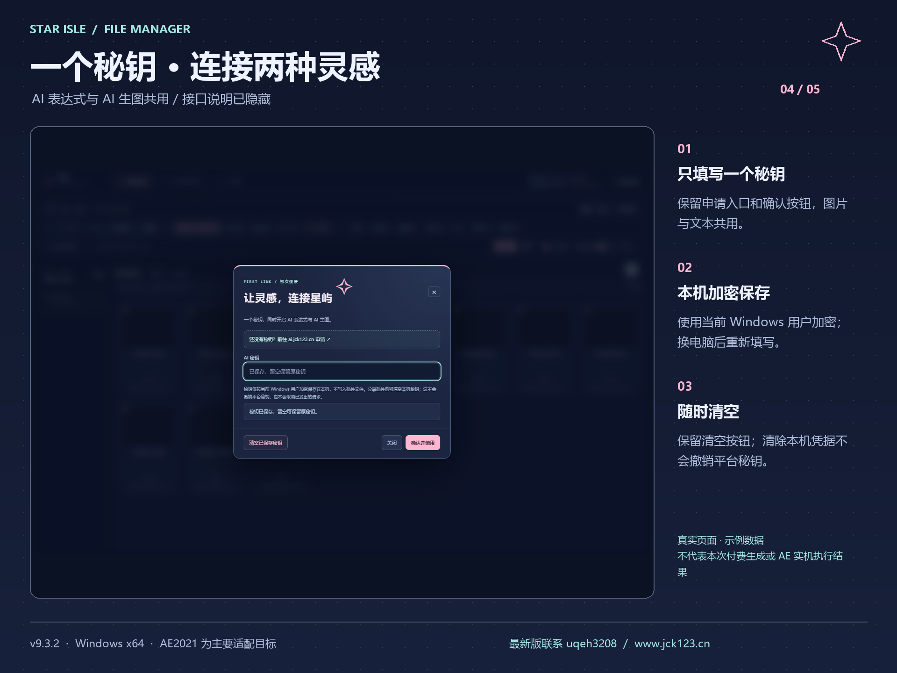
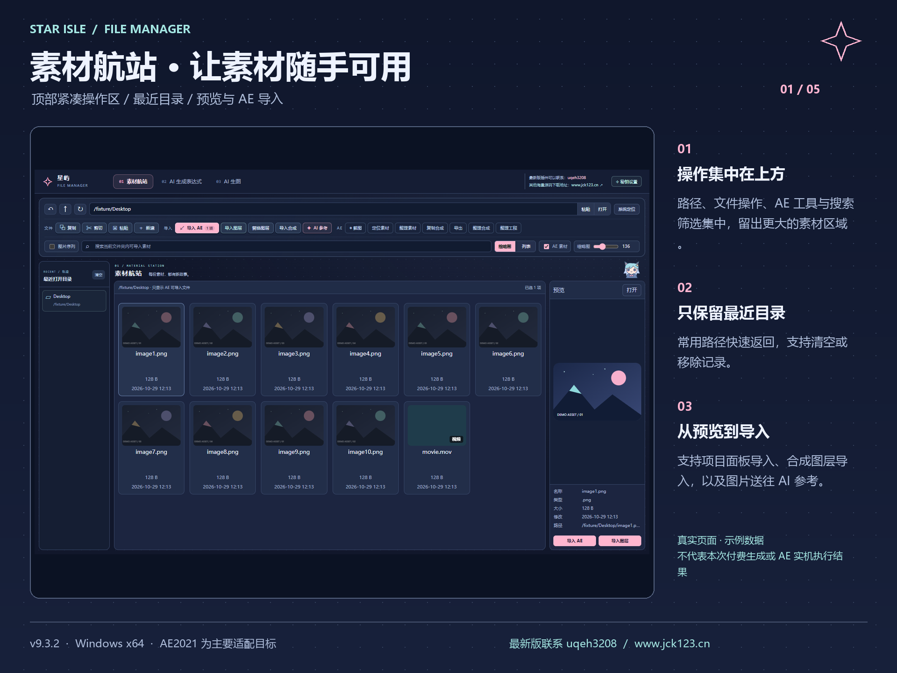
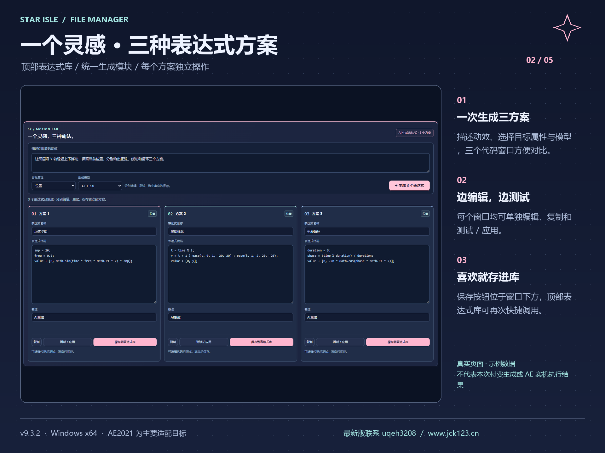
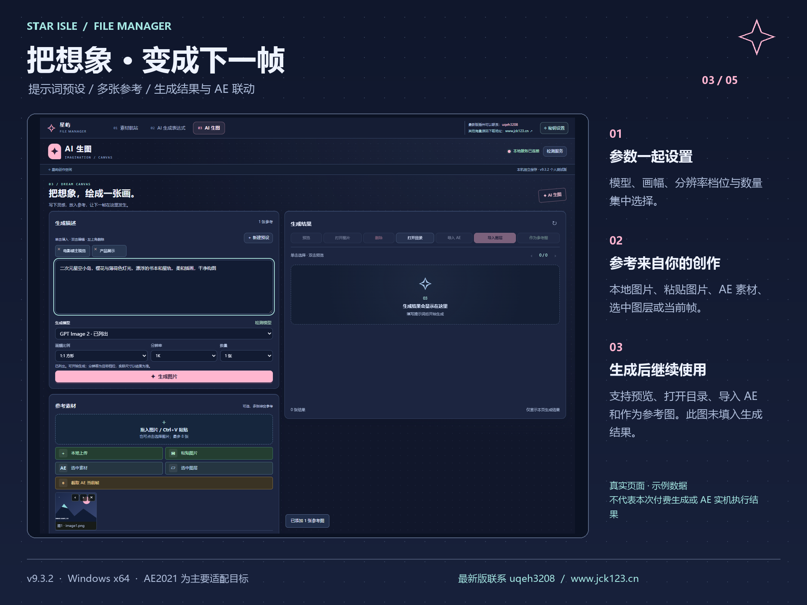

# 星屿 AE 文件管理器 · 完整安装与使用教程

插件版本：v9.3.2｜打包日期：2026-10-29｜Windows x64｜重点适配 AE2021

这份包用于把插件安装到其他电脑。保留素材航站、AI 生成表达式、AI 生图三个模块；文本与图片共用一个秘钥，界面不展示接口地址。安装包附带 Node 22.22.2 x64 和许可证，不需要 npm、数据库、网站后台或单独部署服务器。素材管理可离线使用；AI 功能需要联网、有效秘钥和对应模型权限/额度。

## 01 · 先确认电脑环境

| 项目 | 要求与说明 |
| --- | --- |
| 操作系统 | Windows 10/11 x64；本包不适用于 macOS 或 Windows ARM64 |
| AE | 以 AE2021（18.x）为主要目标，历史记录识别过 18.2.1 / CEP10 |
| 其他 AE 版本 | 清单声明 AE 16.0 起，即 AE2019 起；这只是允许加载的范围，不代表每个版本实机验证通过。必须仍支持 CEP 扩展 |
| Windows 用户 | 每个用户单独安装；请登录实际使用 AE 的 Windows 账户运行安装器 |
| 管理员权限 | 通常不需要，安装在当前用户 AppData；不建议用其他管理员账户代装 |
| 联网 | 安装本身不需要下载 Node；申请秘钥、模型检测、AI 生成需要联网 |
| 磁盘与安全软件 | 预留空间存放安装包、备份和生成结果；企业限制脚本执行时联系本机管理员放行本包 |

如果新版本 AE 的“窗口”菜单没有 CEP 扩展入口，不能仅靠把文件放入 Support Files 解决，需先确认该 AE 版本支持 CEP。本次没有在另一台电脑或全部 AE 版本上实测。

## 02 · 解压并安装：推荐流程

1. 将整个 ZIP 发送到目标电脑，右键“全部解压”。不要直接在压缩软件窗口内运行安装器。
2. 解压到普通本地目录，例如桌面的一个文件夹。目录内应有“开始安装.cmd”、01-Installer、02-安装教程、03-功能展示图。
3. 保存 AE 工程，退出所有版本的 After Effects。必要时在任务管理器确认没有 AfterFX.exe。安装器发现 AE 正在运行会停止，不会替你强制退出。
4. 双击根目录“开始安装.cmd”；也可以打开 01-Installer，双击 install.cmd。弹出的命令窗口会显示校验和安装结果。
5. 看到“Package verified”和“Installed and verified”表示校验、安装成功。窗口内显示的目标目录为当前用户的插件目录。
6. 启动 AE2021，打开“窗口 → 扩展 → 星屿 File Manager”。部分版本或语言环境显示“Extensions”或“Extensions (Legacy)”。
7. 在 AE2021 的“编辑 → 首选项 → 脚本和表达式”中，启用“允许脚本写入文件和访问网络”。其他 AE 版本的对应选项可能位于“常规”或其他首选项分组。
8. 先拉宽面板，建议约 1180 × 780；清单最小宽度为 740。可拖动页签停靠面板，完成首次秘钥设置后开始使用。

安装器会校验全部清单文件的 SHA-256，复制插件及运行环境，为当前用户写入 CSXS.7 至 CSXS.12 的 PlayerDebugMode=1（允许加载此未签名 CEP 扩展），已有安装则先备份。它不会把插件复制到 AE 的 Support Files，也不会改动原版 AEFileManager 扩展。

## 03 · 秘钥设置：只填写一个



1. 第一次打开且没有已保存秘钥时，插件弹出引导窗口；之后可从右上角“秘钥设置”重新打开。
2. 点击“还没有秘钥？前往申请”，在 https://ai.jck123.cn/ 申请平台秘钥。平台权限、计费和额度以平台为准。
3. 将秘钥粘贴到唯一的“AI 秘钥”输入框，点击“确认并使用”。图片和文本共用此秘钥，接口已由程序固定，无需填写地址。
4. 秘钥按当前 Windows 用户 DPAPI 加密保存到本机。保存后输入框清空属于正常行为；已有共用秘钥时，留空确认会保留原值。
5. 旧版若曾使用两个不同秘钥，界面会提示重新填写共用秘钥；填写确认后统一，不会擅自选择其中一个覆盖。
6. 点击“暂不设置”仍可先用素材航站。AI 功能需要设置完成且模型权限可用。

更换 Windows 账户或电脑后需要重新填写秘钥。不要复制旧电脑加密配置来代替设置，也不要将个人秘钥、配置或生成素材打包发给用户。

清除时打开“秘钥设置 → 清空已保存秘钥”，会删除本机 AI 凭据，后续生成需要重新填写。此操作不会撤销平台秘钥，也不会取消已发送的生成请求；秘钥已泄露时应到平台撤销或重置。

## 04 · 素材航站：浏览、预览与 AE 操作



1. 在顶部路径框输入或粘贴素材文件夹地址，点击“打开”，也可用系统定位。
2. 左侧仅显示最近打开目录，可单条移除或清空；顶部支持搜索、缩略图/列表切换、图片序列和 AE 素材筛选。
3. 单击素材查看右侧预览；多选素材后可使用顶部复制、剪切、粘贴和新建按钮。剪切、替换、整理前建议保留工程或素材备份。
4. “导入 AE”把素材导入项目面板；“导入图层”需要有当前合成，会把素材加入时间线。图层替换操作需要事先在 AE 选中目标图层。
5. “AI 参考”把所选图片送到 AI 生图的参考区域；模型、提示词和生成操作在独立生图页完成。
6. 截图、整理素材、整理工程、合成复制和导出等操作需要实际 AE 工程上下文。先用副本工程及少量素材测试，不要把演示图视为这些宿主操作已经在目标电脑验证通过。

格式能否导入最终取决于目标 AE 的格式支持、解码器和文件完整性。PSD 分层导入及重链等复杂工程请在新电脑单独测试。

## 05 · AI 生成表达式：三方案对比



1. 顶部是已有表达式库，可搜索、按属性筛选和快捷应用，也支持导入/导出 JSON。编辑器默认折叠，点击可展开维护条目。
2. 在下方 AI 模块写清楚动效需求，例如“让图层沿 Y 轴上下浮动，保留当前位置，振幅 20，循环 3 秒”。选择与需求一致的目标属性和可用模型。
3. 点击“生成 3 个表达式”，一次请求三个方案。返回后分别显示可编辑代码窗口；宽屏并排，窄窗口纵向排列。
4. 可分别修改名称和代码，使用每个窗口下方的“复制”“测试 / 应用”“保存到表达式库”。
5. 测试前打开 AE 合成并选中适合该属性的图层；应用会修改所选图层的表达式，不会自动创建三个测试图层。需要撤销时在 AE 按 Ctrl+Z。
6. 喜欢的方案保存到表达式库后可从顶部再次调用；同一个结果再次保存会更新该条目。迁移到其他电脑优先使用库的“导出 JSON / 导入 JSON”。

模型可能只返回部分方案或生成不适用代码；以界面提示和 AE 报错为准。检查 2D/3D 维度、属性类型、时间单位及图层引用。请求失败不会自动反复重试；避免连续点击导致重复付费。

## 06 · AI 生图：提示词、参考与结果



1. 点击“检测服务”，再点击“检测模型”，确认本地服务、秘钥和模型权限。能列出模型不等于生成必定成功，还需有可用额度。
2. 输入画面描述；可调用或新建提示词预设。选择模型、画幅比例、1K/2K/4K 目标档位和 1–4 张数量。实际尺寸以模型返回为准。
3. 参考图可选，最多 8 张。支持本地上传、拖入、Ctrl+V、AE 选中素材、时间线选中图层或截取 AE 当前帧。
4. 从 AE 获取参考前，确保有当前合成、合适的选中图层和时间指针；从项目面板读取的素材需要有可访问的图片路径。
5. 点击“生成图片”后等待。生成结果在右侧显示，单击选中、双击预览，可打开图片/目录、导入 AE、导入图层或作为下一次参考。
6. 生成结果默认保存在当前 Windows 用户数据目录的 generated-images。新电脑不会自动带上旧电脑的图片。

401/403 常见于秘钥或权限问题；429 常见于配额/并发限制；超时或上游错误应结合提示及平台状态排查。不要通过修改接口地址来排查，本版固定地址且没有地址编辑入口。

## 07 · 路径、数据和跨电脑迁移

在资源管理器地址栏输入以下路径即可打开；%APPDATA% 通常对应 C:\Users\用户名\AppData\Roaming。

| 内容 | 当前用户路径 |
| --- | --- |
| 插件程序 | %APPDATA%\Adobe\CEP\extensions\AEFileManagerAnime |
| 独立 Node 运行环境 | %APPDATA%\AFMAnimeRuntime\node |
| 个人数据目录 | %APPDATA%\AEFileManager-Anime |
| 素材航站设置与最近目录 | 个人数据目录下的 settings.json |
| 表达式库 | 个人数据目录下的 AE_ScriptManager_expressions.json |
| 生图设置、提示词预设 | 个人数据目录下的 AE_ScriptManager_free_image_settings.json、AE_ScriptManager_free_image_prompts.json |
| 参考副本、生成图 | 个人数据目录下的 reference-images、generated-images |
| 加密秘钥配置（不分发） | 个人数据目录下的 ai-service-config.json |
| 安装升级备份 | %APPDATA%\AEFileManagerAnime-Backups |
| 本地服务日志 | 个人数据目录下的 ai-expression-service.log |

跨电脑安装时发送本 ZIP 即可，目标电脑独立填写自己的秘钥。表达式库用界面导出/导入迁移；需要迁移生成图时单独复制所需图片。参考图、生图设置和最近目录含旧机器路径，复制后需重新选择有效目录或重新添加参考。

不要整包复制 requests、service-info.json、日志及 ai-service-config.json；它们不是可复用安装资源。不要把本机已安装目录直接压缩当作干净安装包。

## 08 · 升级、回退与卸载

升级：先保存工程，等待生成任务结束并关闭 AE，再运行同样的安装器。旧版程序会备份到 AEFileManagerAnime-Backups；个人数据目录不被清空。原版 AEFileManager 可共存，请认准“星屿 File Manager”。当前没有联网自动更新功能，需分发新版安装包并运行安装。

升级后若旧本地服务仍在运行，先关闭插件面板并重新打开；仍未刷新时，等待任务结束后保存工程、重启 Windows，再启动 AE。不要随意终止系统里所有 node.exe，它们可能属于其他软件。

回退：保存并关闭 AE，将当前 AEFileManagerAnime 文件夹移到 extensions 目录之外的安全备份位置；从需要的升级备份中，将 plugin 文件夹复制回 extensions 并命名为 AEFileManagerAnime。保持层级直接包含 CSXS、index.html 等。重新打开 AE。个人数据单独保留，旧版对新版数据的兼容需自行确认。

卸载：需要移除秘钥时先在插件内清空；保存并退出 AE，将 AEFileManagerAnime 文件夹移出 CEP extensions 即可停止加载。个人数据默认可保留；确认不再需要后再手动清理。独立运行环境也仅在确定不再使用本插件时移除。安装器写入的 PlayerDebugMode 可能被其他未签名插件共同使用，不要为卸载本插件批量删除其他插件所需设置。

## 09 · 常见问题排查

| 现象 | 检查方法 |
| --- | --- |
| 双击后报 AE 正在运行 | 保存工程，退出全部 AE 版本后重试；不要强制结束有未保存工程的进程 |
| Missing or changed package file / unexpected files | 重新完整解压原 ZIP；不要修改、删减或向 01-Installer 塞入文件，教程和展示图应留在外层 |
| 安装器被脚本策略或安全软件拦截 | 先核对包来源和校验值，在允许的电脑上运行；企业策略需由管理员处理，不要关闭整机防护 |
| AE 菜单没有星屿 | 确认是在当前 Windows 用户下安装，目录未多套一层，完全重启 AE；确认该 AE 支持 CEP，检查对应 CSXS 的 PlayerDebugMode |
| 面板空白或显示 Node 不可用 | 必须从 AE 扩展入口打开，不能双击 plugin/index.html 代替安装；核对 CSXS/manifest.xml 和运行环境 |
| 文件操作或 AE 截图报权限错误 | 启用 AE 脚本写入/网络选项，选择有读写权限的本地目录，避免只读或失效的路径 |
| AI 服务未响应 | 点击检测服务，核对随包 node.exe 能运行；默认端口 48742；企业策略可能限制本地进程或回环连接 |
| 48742 被占用 | 用下方命令定位进程，确认归属后处理；不要结束无关进程。升级旧服务问题可在任务完成后重启电脑解决 |
| 秘钥无法解密 | 检查是否换了 Windows 账户/电脑；打开秘钥设置重新填写，或清空后重新填写，不复制其他用户的 DPAPI 配置 |
| 秘钥正确但模型检测/生成失败 | 核对平台权限、额度、网络与模型可用性，图片/文本共用秘钥仍需分别具备相应模型权限 |
| 表达式应用无效果或报错 | 检查当前合成、选中图层、目标属性、2D/3D 维度；先复制代码检查，再在测试合成应用 |
| 新电脑找不到旧目录/参考图 | 原数据记录的是旧路径，重新打开有效目录、重新添加参考；生成图需要另行迁移 |

手动校验或安装：在 01-Installer 文件夹的空白处打开 PowerShell，运行以下命令。命令只对本次启动的 PowerShell 指定执行策略，不永久降低整机策略。

```powershell
powershell.exe -NoProfile -ExecutionPolicy Bypass -File ".\install.ps1" -VerifyOnly
powershell.exe -NoProfile -ExecutionPolicy Bypass -File ".\install.ps1"
```

运行环境与端口诊断（只读）：

```powershell
& "$env:APPDATA\AFMAnimeRuntime\node\node.exe" --version
& "$env:APPDATA\AFMAnimeRuntime\node\node.exe" -p process.arch
Test-Path "$env:APPDATA\Adobe\CEP\extensions\AEFileManagerAnime\CSXS\manifest.xml"
Get-NetTCPConnection -LocalPort 48742 -State Listen -ErrorAction SilentlyContinue | Select-Object LocalAddress,LocalPort,OwningProcess
```

正常结果：Node 主版本至少 18、架构 x64、清单 Test-Path 为 True。端口没有输出仅表示当前未监听，不能单独判定网络或秘钥有问题。不要公开秘钥或整个配置文件；反馈时提供 Windows/AE 版本、完整报错及脱敏后的相关日志。

## 10 · 安装完成后的五分钟自检

1. 素材航站能打开一个本地测试文件夹，缩略图/列表和预览正常。
2. 新建 AE 测试合成，导入一张本地图片到项目面板，再测试导入图层。
3. 秘钥设置仅有一个输入框，能保存，重开面板不重复要求填写。
4. AI 表达式先用测试图层生成三方案，检查、应用并撤销，保存一条后从顶部库调用。
5. AI 生图先检测服务及模型，再按需生成一张低成本测试图，检查预览、打开目录和导入。生成会使用平台额度，检测成功不代表已完成真实生成测试。

本次交付已核对当前安装与源码的 25 个插件文件一致，并通过干净隔离目录的新装、升级备份、数据保留、损坏包拒绝及真实页面展示检查。安装教程和展示图不构成全部 AE 版本或另一台电脑实机验证；本次未调用付费 AI，也未修改实际 AE 工程。

## 11 · 包内容与联系

01-Installer 是原 v9.3.2 完整安装器及运行文件，保持原校验清单；02-安装教程提供本教程 Markdown 与可直接双击阅读的 HTML；03-功能展示图包含五张功能介绍 PNG 和原始界面图。

展示图使用真实 v9.3.2 页面，在隔离模拟 CEP 环境中填入示例目录、图片和表达式。图中的连接状态、示例代码不是本次付费 API 或真实 AE 执行结果；生图页未伪造生成结果。请按本教程自检目标电脑的实际效果。

最新版插件可以联系：uqeh3208。其他海量源码下载地址：https://www.jck123.cn/ 。
