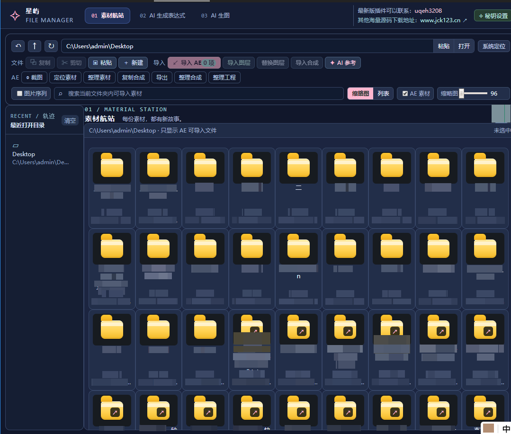
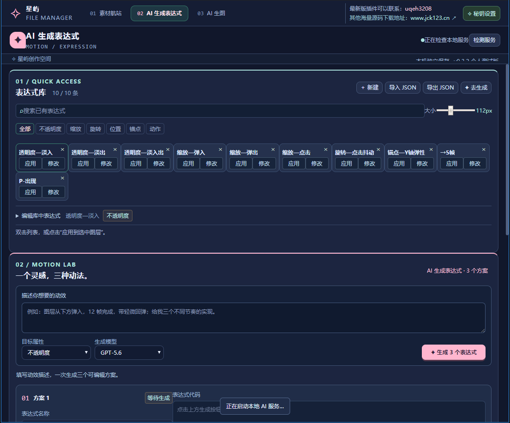
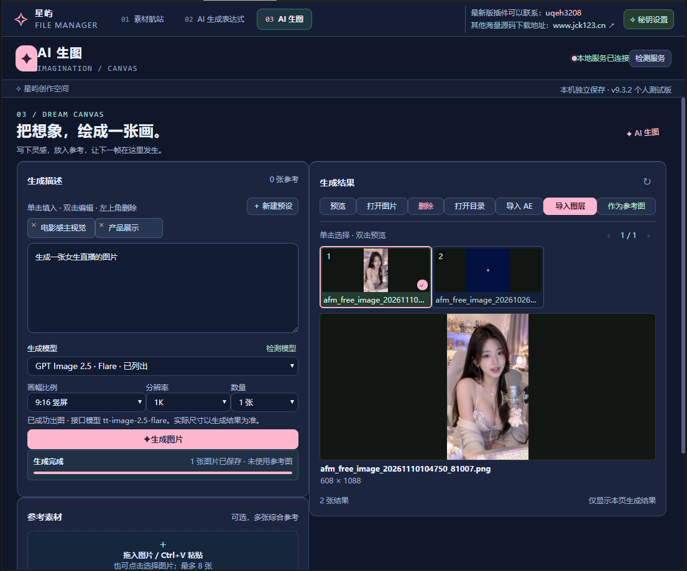
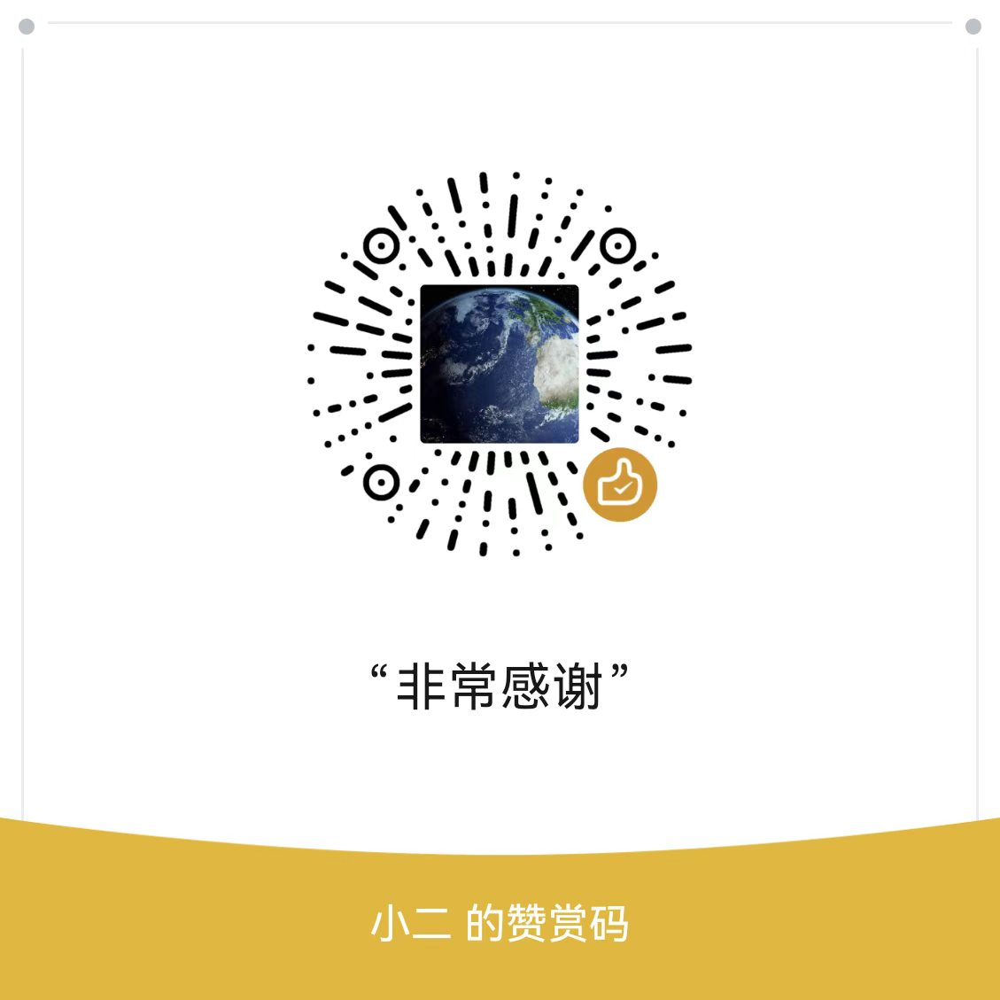

# 星屿 AE 文件管理器

**让素材预览、表达式编写和 AI 生图，在 AE 的同一个扩展面板里衔接起来。**

做 AE 项目时，你可能经常在资源管理器、表达式代码和生图工具之间来回切换：找到一张图，要导入合成；想到一个动效，要写代码、改参数；缺少画面素材，又要去别处生成再下载。

星屿 AE 文件管理器将这些操作集中到一个 CEP 扩展中，提供 **素材航站、AI 生成表达式、AI 生图** 三个独立页面。你可以先浏览本地素材，再把图片导入项目或当前合成；也可以用文字描述动效，比较三个表达式方案，把合适的代码存入自己的表达式库。

**当前版本：v9.3.2 · Windows 10/11 x64 · 以 AE2021 为主要适配目标。**

下方三张功能演示图由作者提供，分别展示素材航站、AI 生成表达式和 AI 生图页面。

## 三个页面，分别解决什么问题

| 页面 | 主要用途 | 典型操作 |
| --- | --- | --- |
| 素材航站 | 找素材、看预览，把文件接入 AE 工程 | 打开目录、搜索、缩略图／列表、导入 AE、导入图层、替换图层 |
| AI 生成表达式 | 将动效需求转为三个可比较、可编辑的代码方案 | 描述需求、选择属性、生成方案、测试／应用、保存表达式库 |
| AI 生图 | 从提示词与参考图出发生成素材，再继续用于 AE | 提示词预设、参考图、模型与参数选择、结果预览、导入图层 |

素材管理可以离线使用；AI 功能需要联网、有效密钥和相应模型权限及额度。

## 01 · 素材航站：找到素材后，直接继续做



素材航站把本地文件浏览和 AE 常用操作放在同一页：左侧快速返回最近打开的目录，中间用缩略图或列表查找素材，上方集中提供路径导航、搜索、文件操作和 AE 素材筛选。找到需要的文件后，可以导入项目面板、加入当前合成或替换选中图层；配合截图、定位素材、复制合成和工程整理入口，减少在资源管理器与 AE 之间来回切换的步骤。

- **浏览与筛选：** 支持目录导航、搜索、缩略图与列表切换、缩略图尺寸调整、AE 素材筛选和图片序列选项。
- **文件操作：** 提供复制、剪切、粘贴、新建文件夹及系统定位入口。
- **导入与替换：** 可导入 AE 项目面板、导入当前合成图层、替换已选图层，以及导入合成。
- **AE 工程工具：** 提供当前帧截图、定位素材、整理素材、复制合成、导出、整理合成和整理工程入口。
- **连接 AI 生图：** 选中支持的图片后，点击“AI 参考”，将图片送往生图页继续使用。

### 试一次：把图片加入当前合成

1. 在 AE 新建一个测试合成。
2. 在素材航站打开本地图片文件夹，选中一张图片并查看预览。
3. 点击“导入 AE”，将图片导入项目面板；或点击“导入图层”，直接加入当前合成。
4. “导入图层”按当前时间指针放置，进行适配与居中；具体行为可查看 [AE 宿主脚本](01-Installer/plugin/jsx/host.jsx)。
5. 需要换图时，在 AE 选中目标图层，再回到插件选择新素材，点击“替换图层”。

导入、替换、截图和工程整理依赖 AE 当前合成与选中对象。首次使用建议先在副本工程中测试，格式兼容性以目标 AE 为准。

## 02 · AI 表达式：一个需求，对比三个方案



AI 生成表达式将常用代码库与动效生成放在一起。上方表达式库可按不透明度、缩放、旋转、位置等属性筛选，支持搜索、修改、应用及 JSON 导入导出；下方用自然语言描述动效，选择目标属性与可用模型后，可请求三个可编辑方案。生成后逐个调整、测试，再把满意的代码保存到库中，让常用动效逐渐积累成自己的表达式工具箱。图中展示的是表达式库和生成入口，方案区尚在等待生成。

- **三个方案独立操作：** 分别编辑、复制、测试／应用、保存到表达式库。
- **常用代码留在库里：** 顶部表达式库支持搜索、属性筛选、拖动排序，以及 JSON 导入／导出。
- **继续生成变体：** 可基于库编辑器当前代码生成三个变体。
- **减少误覆盖：** 替换未保存结果前会确认；生成失败保留已有结果，同一结果再次保存会更新原条目。

### 试一次：生成一个循环浮动效果

1. 在 AE 测试合成中选中一个适合应用位置表达式的图层。
2. 打开“AI 生成表达式”，选择“位置”属性和可用模型。
3. 输入需求，例如：

   ```text
   让图层沿 Y 轴上下浮动，保留当前位置，振幅 20，循环 3 秒。
   给出三种实现方式，便于比较运动节奏。
   ```

4. 点击“生成 3 个表达式”，检查各方案代码，再分别点击“测试／应用”。
5. 调整参数后重新应用，满意后保存到表达式库，下次从顶部库调用。

“测试／应用”会修改所选图层的表达式，不会自动创建三个测试图层。AI 输出仍需检查属性类型、2D／3D 维度和图层引用；需要撤销时，可在 AE 使用 `Ctrl+Z`。

## 03 · AI 生图：从参考到素材，接着用在工程里



AI 生图把画面描述、模型参数、参考素材和结果管理集中在一个工作区。左侧输入提示词，选择模型、比例、分辨率档位与数量，也可添加本地图片或 AE 画面作为参考；右侧查看结果缩略图与大图预览，并继续打开图片、定位目录、导入 AE 或作为下一次参考。图中展示了竖屏画面的生成结果与预览，让“描述画面—查看结果—加入工程”的操作衔接得更直接。

- **提示词预设：** 保存常用描述，单击填入，双击编辑。
- **生成参数：** 选择可用模型、画幅比例、1K／2K／4K 目标档位及 1–4 张数量。
- **多种参考来源：** 支持本地上传、拖入、粘贴图片、AE 选中素材、选中图层和截取当前帧，最多 8 张参考图。
- **生成后继续使用：** 支持预览、打开图片或目录、导入 AE、导入图层，以及把结果作为下一次参考。

### 试一次：参考现有画面生成新素材

1. 打开“AI 生图”，点击“检测服务”和“检测模型”。
2. 输入画面描述，选择当前账号可用的模型与参数。
3. 按需添加参考图；从 AE 获取参考时，先准备当前合成、时间指针和选中对象。
4. 点击“生成图片”，等待实际服务返回结果。
5. 选中结果查看预览，再导入项目面板或当前合成。

生成会使用服务平台额度。检测到模型不等于生成必定成功；实际分辨率、数量、参考图能力和计费以模型及服务平台为准。

## 快速安装

### 环境要求

| 项目 | 说明 |
| --- | --- |
| 系统 | Windows 10/11 x64；本包不适用于 macOS 或 Windows ARM64 |
| AE | 以 AE2021 为主要目标；其他版本需支持 CEP 并单独验证 |
| Node.js | 安装包附带 Node 22.22.2 x64，无需另外运行 npm 安装依赖 |
| 服务部署 | 不需要自建网站后台或数据库；AI 请求经本地服务转发至预设平台 |
| 网络 | 本地素材管理可离线使用；AI 功能需要联网 |

### 安装步骤

1. 在 GitHub 选择 **Code → Download ZIP**，完整解压仓库，保留安装目录结构。
2. 保存 AE 工程，关闭所有正在运行的 AE。
3. 双击根目录的 [`开始安装.cmd`](开始安装.cmd)。通常无需管理员权限。
4. 安装器显示 `Package verified` 和 `Installed and verified` 后，重新打开 AE。
5. 在 **窗口 → 扩展 → 星屿 File Manager** 打开插件。
6. 在 AE 首选项中启用 **允许脚本写入文件和访问网络**。
7. 首次打开时设置 AI 密钥；也可以先跳过，使用本地素材管理。

安装器将插件放到当前用户的 CEP 扩展目录，附带文件完整性检查和已有安装备份；不会强制关闭 AE。请将 README、截图等文档保留在安装器目录之外，避免触发安装包额外文件检查。

完整操作与排错请看：[完整安装与使用教程](02-安装教程/完整安装与使用教程.md)。也可以在本地双击同目录的 HTML 教程阅读。

## AI 密钥设置

本版图片与文本共用一个密钥，可从右上角“秘钥设置”进入保存或清空。

- 申请入口：[ai.jck123.cn](https://ai.jck123.cn/)。
- 本版预设接口为 `https://api.lk888.ai/v1`，设置页没有自定义接口地址入口。
- 密钥通过当前 Windows 用户的 DPAPI 加密保存到本机，更换电脑或 Windows 账户后需要重新填写。
- 清空本机密钥不会撤销平台密钥，也不会取消已经发出的请求。

密钥、额度、平台可用性和模型权限以实际服务为准。仓库不附带个人密钥、用户配置或生成图片。

## 数据保存与迁移

| 内容 | 位置／方式 |
| --- | --- |
| 插件目录 | `%APPDATA%\Adobe\CEP\extensions\AEFileManagerAnime` |
| Node 运行环境 | `%APPDATA%\AFMAnimeRuntime\node` |
| 个人数据 | `%APPDATA%\AEFileManager-Anime` |
| 安装备份 | `%APPDATA%\AEFileManagerAnime-Backups` |
| 表达式库迁移 | 从界面导出 JSON，再到新电脑导入 |
| 生成图片迁移 | 单独复制需要的图片，默认位于个人数据的 `generated-images` |

换电脑时完整安装插件、重新填写密钥，并重新选择有效素材路径。不要将日志、请求记录或加密配置当作公共安装资源上传。

升级前保存工程、等待生成任务结束并退出 AE，再运行新版安装器。当前版本没有联网自动更新功能。

## 源码结构

```text
.
├─ README.md
├─ docs/images/                  # 作者提供的三张功能演示图
├─ 开始安装.cmd
├─ 01-Installer/
│  ├─ install.ps1                 # 校验、安装与备份
│  ├─ package-manifest.json       # 安装文件 SHA-256 清单
│  ├─ plugin/
│  │  ├─ index.html / main.js     # 素材航站
│  │  ├─ ai-expression.html/js    # 表达式页面（对应两个文件）
│  │  ├─ ai-image.html/js         # 生图页面（对应两个文件）
│  │  ├─ ai-settings.js           # 共用密钥设置
│  │  ├─ ai-service/              # 本地 Node 服务、模型适配与凭据保存
│  │  ├─ jsx/host.jsx             # AE ExtendScript 宿主操作
│  │  ├─ CSXS/manifest.xml        # CEP 配置
│  │  └─ data/                    # 默认表达式数据
│  └─ runtime/node/               # Node 运行文件与第三方许可证
├─ 02-安装教程/                    # Markdown 与离线 HTML 教程
└─ 03-功能展示图/                  # 功能介绍图与原始界面截图
```

前端采用 HTML、CSS、JavaScript，通过 CEP 与 AE 宿主脚本通信；本地 Node 服务处理 AI 请求和相关文件操作。

开发入口：[素材航站](01-Installer/plugin/main.js) · [表达式页面](01-Installer/plugin/ai-expression.js) · [生图页面](01-Installer/plugin/ai-image.js) · [AE 宿主脚本](01-Installer/plugin/jsx/host.jsx) · [本地服务](01-Installer/plugin/ai-service/ai-expression-service.js)。

安装器会检查 `01-Installer` 内全部清单文件。修改源码后，需要重新生成并核对相应清单，再制作自己的分发包；直接修改后继续运行原安装器，会被完整性检查拒绝。

## 常见问题

**AE 中找不到插件？**

确认使用实际运行 AE 的 Windows 账户安装，完整退出后重开 AE，并确认目标版本仍支持 CEP。安装目录应直接包含 `CSXS` 和 `index.html`。

**双击 HTML 能当网页版用吗？**

完整功能依赖 CEP、Node 和 AE 宿主环境，应从 AE 扩展菜单进入。普通浏览器打开页面不能代替安装。

**AI 检测成功，为什么仍然生成失败？**

还需检查平台额度、模型权限、网络和实际错误信息。不要连续重复点击生成；当前版本没有自定义接口地址设置。

**表达式报错怎么办？**

先核对目标属性、选中图层与维度，再检查代码。建议在测试合成中应用，确认后再用于正式工程。

**是不是所有 AE 版本都已验证？**

不是。清单允许加载的版本范围不代表逐一实测。AE2021 为主要目标，其他版本及不同电脑需按安装教程自检。

## 展示与验证说明

本仓库介绍依据 v9.3.2 源码、随包教程及作者提供的三张界面截图整理。本文使用 `docs/images/` 中的作者截图；`03-功能展示图/` 仍保留安装包原有的模拟 CEP 展示资料，两者来源不同。

作者提供的生图截图中可见生成结果与图片预览；本轮文档整理未重新执行生成或 AE 宿主操作。使用中的具体效果，请按教程在自己的环境验证。

## 开源协议

本项目原创代码采用 [MIT License](LICENSE)，允许使用、修改和商业分发，须保留版权与许可声明。随包 Node.js 等第三方组件遵循其各自许可证，见 `01-Installer/runtime/node/LICENSE`。

## 星屿作者开源文章

作者发布页：**[星屿作者开源文章](https://www.jck123.cn/archives/24)**。

如果你是从 GitHub 认识这个插件，也欢迎访问作者原文，结合仓库中的源码和安装教程了解项目，让这份工具更容易找到、上手和继续完善。

---

## 给经常做 AE 项目的你

如果你也经常翻素材目录、反复找表达式、生成图片后再导回 AE，可以把星屿留在工作区里，从自己最常用的一项操作开始试试。觉得有用，欢迎给仓库点个 Star；遇到问题也欢迎附上版本和报错反馈。

除了这个插件，我也在 **[www.jck123.cn](https://www.jck123.cn/)** 整理源码和实用工具。下次想给创作流程添一个顺手的小工具，欢迎来逛逛，或许就能少一次到处翻找。

## 联系作者与支持开源

### 微信交流

想交流 AE 素材管理、表达式或插件使用心得，欢迎扫码添加作者微信，备注“星屿 AE 文件管理器”，方便我了解你的来意。


### 自愿赞赏

如果星屿帮你省下了找素材、写表达式的时间，也欢迎自愿赞赏，支持后续维护与文档整理。每一份支持，都是继续分享实用工具的鼓励；是否赞赏不影响按 MIT 协议使用本项目。


